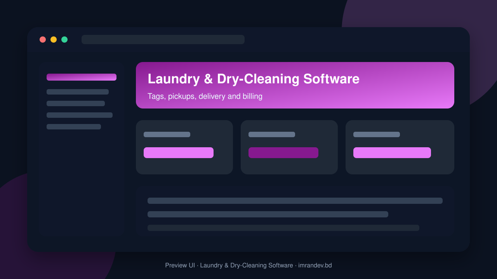
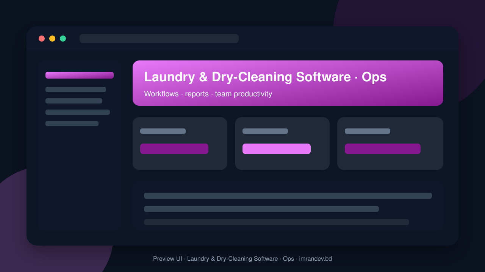

<p align="center">
  
</p>

<h1 align="center">Laundry & Dry-Cleaning Software</h1>

<p align="center"><strong>Tags, pickups, delivery and billing</strong></p>

<p align="center">
  <a href="https://github.com/imranbru99/laundry-dry-cleaning-software-billing"></a>
  
  
</p>

---

## Overview

**Laundry & Dry-Cleaning Software** is a complete business application focused on real operational workflows. This README lists the full feature surface so GitHub visitors and search engines can understand every capability of the product.

## Product preview

| Dashboard | Operations |
| :---: | :---: |
|  |  |

## Complete feature list

### Application modules

- Accounting
- Ai Suite
- B2b
- Billing
- Catalog
- Cms
- Communication
- Core
- Crm
- Franchise
- Hr
- Integrations
- Inventory
- Logistics
- Loyalty
- Orders
- Production
- Reports
- Self Service
- Subscriptions
- Support
- Tagging

### Admin / Filament resources

- Catalog Item
- Catalog Service
- Claim
- Contract
- Coupon
- Customer
- Delivery
- Employee
- Garment Tag
- Invoice
- Order
- Payment
- Pickup
- Plan
- Subscription
- Tenant

### Domain models

- Ai Output
- Belongs To Tenant
- Branch
- Catalog Item
- Catalog Service
- Claim
- Cms Page
- Contract
- Coupon
- Customer
- Customer Address
- Delivery
- Employee
- Garment Tag
- Invoice
- Module
- Order
- Order Item
- Payment
- Pickup
- Plan
- Price Matrix
- Service Category
- Subscription
- Tenant
- Tenant Module

### HTTP / API controllers

- Module APIs & screens
- Order APIs & screens
- Public Site APIs & screens

### Detailed feature requirements delivered

- AI Agent Build Prompt: Laundry and Dry-Cleaning Software
- ROLE AND MISSION
- MANDATORY PACKAGES (read the README of each first)
- Integrate any attendance machine (biometric, RFID, face) for staff attendance, shifts and payroll.
- Generate PDFs in any language (invoices, tags, receipts, reports, contracts). Bangla, Arabic, Hindi, CJK etc. must render correctly.
- ARCHITECTURE REQUIREMENTS
- Service ModuleManager::isEnabled($key, $tenant, $branch = null).
- Dependency handling: enabling a module auto-suggests/enables dependencies; disabling a module warns about dependents.
- Feature flags tied to subscription plans: plan defines which modules are available; tenant chooses which to turn on.
- Clean code: Service classes, Actions, DTOs, Form Requests, Policies, Events/Listeners, Queued jobs, Enums, API Resources. PSR-12, strict types, Pint and PHPStan (level 6+).
- Queues and scheduler (Redis or database), Horizon-ready. Audit log on all critical models. Soft deletes where sensible. Activity timeline on orders.
- Localization: full i18n (English + Bangla + Arabic + Spanish + Hindi shipped), RTL support, per-tenant default language, multi-currency, timezone, tax and number/date formats.
- API: versioned REST API (/api/v1) with Sanctum for mobile apps, plus OpenAPI/Swagger docs. Webhooks for order events.
- USER TYPES (multi-role)
- Platform Super Admin: manages tenants, plans, modules registry, global settings, billing of tenants, support.
- Platform Support Agent: impersonation (audited), tenant support tools.
- Business Owner: full control of own business, branches, modules, billing, reports.
- Business Manager / Branch Manager: branch operations, staff, approvals, reports.
- Cashier / Front-desk: POS, order intake, payments, tags, pickup counter.
- Garment Tagger / Intake Operator: inspection, tagging, photos, stain/damage notes.
- Production Operator: washing, dry-cleaning, pressing, finishing, QC stations.
- Quality Controller: re-wash/re-clean decisions, defect logging.
- Driver / Delivery Rider: routes, pickups, deliveries, proof of delivery, cash collection.
- Dispatcher / Logistics Coordinator: route planning, driver assignment.
- Accountant: invoices, expenses, tax, reconciliation, financial reports.
- Inventory / Store Keeper: chemicals, hangers, bags, supplies, purchase orders.
- HR Officer: staff, attendance, leave, payroll.
- Marketing Officer: campaigns, coupons, loyalty, referrals, website content.
- Customer (individual): portal and app, orders, tracking, wallet, subscriptions.
- Corporate / B2B Customer: hotels, hospitals, restaurants, uniform accounts, contract pricing, consolidated invoices, sub-users.
- Franchise Owner / Partner / Agent: own outlets, royalty and commission tracking.
- Vendor / Subcontractor Laundry: receives outsourced batches, invoices the business.
- Supplier: purchase orders and deliveries.
- Guest: public visitors (tracking, price list, booking).
- COMPLETE MODULE LIST (every one toggleable)
- Rack/slot/conveyor location assignment, bagging/hanger assignment, order consolidation checks ("all items present?") before delivery.
- Public tracking page by tag/order number (signed URL + OTP option).
- Garment photo analysis: detect type, color, stains, damage, and suggest service and price.
- Customer support chatbot (public site, customer portal, WhatsApp).
- Natural-language report assistant ("show last month's revenue by branch").
- PUBLIC PAGES (marketing + customer-facing)
- Home: hero, value proposition, live order tracking box, service highlights, how-it-works, pricing teaser, stats, testimonials, app download, CTA.
- Features: one section per module (all of section 4) with icons, screenshots/mockups and "on/off per business" explanation.
- Modules/Solutions by business type: dry-cleaner, wash-and-fold, hotel/linen, uniform rental, self-service launderette, franchise chain.
- Pricing/Plans: plan comparison table driven from the database, module availability per plan, monthly/yearly toggle, local currency.
- Live Demo page: one-click login buttons for every demo user role (see section 7), reset-demo notice.
- Book a Pickup / Schedule: public booking form with slot picker, address/map pin, guest checkout and OTP.
- Track Order: by order number or tag with timeline.
- Legal: terms, privacy, refund policy, cookie policy.
- Customer Portal entry (login/register, social login, OTP login).
- FILAMENT UI REQUIREMENTS
- Role-aware dashboards: each user type sees tailored widgets.
- DEMO DATA AND DEMO USERS
- Create seeders (php artisan migrate:fresh --seed) that produce a rich, realistic demo:
- END-TO-END FLOWS THAT MUST WORK
- B2B hotel linen: counted-in sheet, contract pricing, month-end consolidated invoice, statement email.
- Staff attendance from a (simulated) machine log, then payroll, then payslip PDF.
- Disabling a module (e.g., Loyalty) hides its menus, routes, widgets, API and public pages, and re-enabling restores them with data intact.
- NON-FUNCTIONAL REQUIREMENTS
- Performance: eager loading, indexes, caching, queued heavy work, N+1 prevention tests; use drutogoti per its README.
- Test coverage: Pest/PHPUnit feature and unit tests for services, policies, module toggles, money calculations (use integer minor units or a money library), and tenancy.
- EXECUTION PLAN (follow in order)
- Build core + CRM + catalog + orders/POS + tagging + billing (the revenue path), with tests.
- Final report: list of modules delivered, any gaps with reasons, how to run, demo credentials.
- RULES FOR THE AGENT

### Platform capabilities

- Multi-role ready structure for operators, managers and admins
- Database migrations and seeders for demo-ready local setup
- Laravel architecture with services/controllers/models separation
- Responsive UI foundation (Blade / Filament where enabled)
- Environment-based config for local and production databases
- GitHub-ready documentation with visual product previews

## Tech stack

- PHP 8.2+ / Laravel
- Filament admin resources (where enabled)
- Vite asset pipeline
- SQLite/MySQL-ready database layer
- Migrations, seeders, and test-ready structure

## Quick start

```bash
git clone https://github.com/imranbru99/laundry-dry-cleaning-software-billing.git
cd laundry-dry-cleaning-software-billing
composer install
cp .env.example .env
php artisan key:generate
php artisan migrate --seed
npm install && npm run build
php artisan serve
```

## Repository

- GitHub: https://github.com/imranbru99/laundry-dry-cleaning-software-billing
- Developer: **Imran Ahmed** · https://imrandev.bd

---

## 🤝 Let's Connect & Collaborate

I am open to **Senior Remote Full-Stack Roles**, AI Platform Architecture Contracts, and Enterprise Technical Advisory.

**Timezone:** UTC+6 (Dhaka / Rangpur, Bangladesh) — flexible overlap with US, UK & EU hours.  
**Delivery:** Async-ready · Slack · Discord · Jira · GitHub · production-first accountability.

| Channel | Handle | Link |
| :--- | :--- | :--- |
| Portfolio | imrandev.bd | https://imrandev.bd |
| Packagist | imrandevbd | https://packagist.org/packages/imrandevbd/ |
| LinkedIn | imranbru99 | https://linkedin.com/in/imranbru99 |
| GitHub | imranbru99 | https://github.com/imranbru99 |
| WhatsApp | +880 1576-918420 | https://wa.me/8801576918420 |
| Email | me@imrandev.bd | mailto:me@imrandev.bd |
| X | @imrandev_bd | https://x.com/imrandev_bd |
| YouTube | @ImranDevBD | https://youtube.com/@ImranDevBD |
